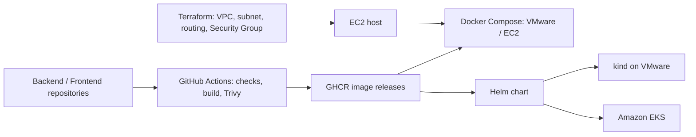

# URL Shortener Infrastructure

Cấu hình triển khai và vận hành URL Shortener từ Ubuntu trên VMware đến AWS EC2 và Amazon EKS. Dự án thực hành Docker, CI, Infrastructure as Code, Kubernetes, monitoring và troubleshooting trên ứng dụng Spring Boot/React với PostgreSQL, Redis và Kafka.

[Portfolio và kết quả thực hành](docs/PORTFOLIO.md) · [Backend](https://github.com/ThanhND05/url_shortener_be) · [Frontend](https://github.com/ThanhND05/url_shortener_fe)

## Kiến trúc và phạm vi



Terraform tạo hạ tầng EC2. Cluster EKS được tạo bằng **eksctl**, ứng dụng được triển khai bằng **Helm**. Các môi trường Compose, kind và EKS dùng database riêng trong luồng thực hành hiện tại.

| Thành phần | Phạm vi |
|---|---|
| VMware / EC2 | Docker Compose và Nginx reverse proxy |
| CI ứng dụng | Kiểm tra ứng dụng, build image, scan Trivy và publish GHCR |
| CD EC2 | Workflow kích hoạt thủ công, deploy qua SSH, health/smoke và logic phục hồi release |
| Kubernetes | Helm chart cho app và data services, probes, ConfigMap, Secret references và PVC |
| EKS | Managed node group, EBS CSI và Pod Identity; deploy Helm từ VMware |
| Quan sát | Prometheus, Grafana và bài kiểm tra redirect bằng k6 |

Đây là **personal lab**, mỗi data service có một replica. EKS hiện truy cập qua **port-forward và SSH tunnel**; AWS từ chối tạo NLB ở cấp tài khoản, nên public NLB/TLS chưa hoàn thành. Incident và bằng chứng nằm trong portfolio.

[Report k6 VMware](docs/evidence/k6-vm.json) ghi nhận 3.192 request trong khoảng 2 phút, tối đa 10 VU, p95 khoảng **9,89 ms**, HTTP failure **0%**. Đây là phép đo endpoint redirect không follow destination trong lab, không phải benchmark EKS hoặc công suất tối đa.

## Cấu trúc repository

```text
url-shortener-infra/
├── .github/workflows/        # Workflow thật của repo infra
├── bootstrap/               # Chuẩn bị EC2 host và host Nginx
├── charts/url-shortener/    # Helm chart app và data services lab
├── compose/                 # Compose, overrides và frontend Nginx
├── docs/                    # Guide, portfolio, incident và evidence
├── environments/
│   ├── aws-lab/             # Terraform cho EC2 lab
│   └── dev/                 # Cấu hình GCP từ giai đoạn trước
├── k8s/                     # kind, EKS, StorageClass và values
├── load-tests/              # Workload k6
├── modules/                 # Terraform modules của giai đoạn GCP
├── monitoring/              # Prometheus / Grafana
├── scripts/                 # Env, smoke, deploy, backup và restore
└── .env.example             # Biến cấu hình, không có secret thật
```

Workflow và backend profile được duy trì trực tiếp trong repo sử dụng chúng. Các bản copy cũ trong `workflow-examples/` và `backend-examples/` đã được bỏ.

## Tài liệu và source chính

| Mục tiêu | Tài liệu / source |
|---|---|
| Xem dự án và kết quả | [Portfolio](docs/PORTFOLIO.md) |
| Deploy toàn stack trên kind rồi EKS | [Guide Kubernetes → EKS](docs/kubernetes-eks-intern-guide.md) |
| Thiết lập CD EC2 | [Guide CD AWS](docs/aws-cd-guide.md) |
| Cấu hình EC2 | [Terraform AWS lab](environments/aws-lab/) và [bootstrap](bootstrap/) |
| Cấu hình Kubernetes | [Helm chart](charts/url-shortener/) |
| Monitoring / workload | [Monitoring](monitoring/) và [k6 script](load-tests/redirect.js) |
| Phạm vi validation | [Compose/scripts](docs/VALIDATION.md) và [Kubernetes](docs/K8S_VALIDATION.md) |

[Bài kind bridge cũ](docs/kubernetes-vmware-guide.md) giữ data services ở Compose; luồng Helm/EKS mới chạy cả stack trong Kubernetes. Chọn một bài phù hợp, không cần chạy cả hai cùng lúc.

## Quick start trên Ubuntu VMware

Cần Docker Engine và Compose plugin. Clone BE, FE và infra thành ba thư mục cạnh nhau để build context hoạt động:

```bash
mkdir -p ~/projects
cd ~/projects
git clone https://github.com/ThanhND05/url_shortener_be.git
git clone https://github.com/ThanhND05/url_shortener_fe.git
git clone https://github.com/ThanhND05/url-shortener-infra.git
cd url-shortener-infra
bash scripts/init-env.sh
nano .env
```

`init-env.sh` chỉ chạy một lần và từ chối ghi đè `.env` đã có. Backend image cần chứa profile `src/main/resources/application-lab.yaml` trong repo backend.

Trong `.env`, đặt `WEB_BIND=0.0.0.0`, `WEB_PORT=8080` nếu muốn mở từ Windows qua IP VM. Cập nhật `FRONTEND_URL`, `ALLOWED_ORIGINS` và `VNPAY_RETURN_URL` theo cùng địa chỉ, ví dụ `http://192.168.40.100:8080` và callback `/api/v1/billing/vnpay-return`. Thay IP bằng địa chỉ VM thực tế, giữ các password đã sinh.

```bash
docker compose --env-file .env -f compose/compose.yml -f compose/compose.vm.yml config --quiet
docker compose --env-file .env -f compose/compose.yml -f compose/compose.vm.yml build
docker compose --env-file .env -f compose/compose.yml -f compose/compose.vm.yml up -d --wait --wait-timeout 300
bash scripts/smoke.sh init
bash scripts/smoke.sh run
```

Mở `http://<VM_IP>:8080`. Smoke `init` tạo tài khoản/link và fixture một lần; các lần sau chỉ `run`. Môi trường có DB riêng cần fixture riêng như guide Kubernetes hướng dẫn.

Khi chuyển sang image GHCR đã qua CI, dùng manifest chứa digest và pull/deploy thay cho build source trên server. [Script deploy](scripts/deploy.sh) yêu cầu `.env` và fixture smoke hợp lệ; xem guide CD để thiết lập release đầu và quyền registry.

## Workflow trên GitHub

| Repository | Workflow | Cách chạy |
|---|---|---|
| Backend | [backend-ci.yml](https://github.com/ThanhND05/url_shortener_be/blob/main/.github/workflows/backend-ci.yml) | Theo trigger của repo backend |
| Frontend | [frontend-ci.yml](https://github.com/ThanhND05/url_shortener_fe/blob/main/.github/workflows/frontend-ci.yml) | Theo trigger của repo frontend |
| Infra | [deploy-lab.yml](.github/workflows/deploy-lab.yml) | Run workflow trên main; cần Environment aws-lab, IAM keys và SSH secrets |
| Infra | [k8s-chart-ci.yml](.github/workflows/k8s-chart-ci.yml) | Lint/render chart khi đường dẫn liên quan thay đổi |
| Infra | [terraform-ci.yml](.github/workflows/terraform-ci.yml) | Format-check Terraform toàn repo; init/validate môi trường GCP environments/dev |

Terraform AWS hiện cần kiểm tra riêng trong `environments/aws-lab`: `terraform fmt -check`, `terraform init -backend=false`, `terraform validate`. Workflow Terraform hiện có chưa validate AWS. CD EC2 không deploy EKS; luồng EKS hiện chạy Helm thủ công từ VMware.

## Đồng bộ Windows và VMware qua Git

GitHub là nơi trao đổi code giữa hai máy. Sửa/copy file trên VMware chỉ thay đổi filesystem của VM; Windows nhận được sau khi file đã **add → commit → push**, rồi Windows pull đúng repository/branch.

```text
Windows hoặc VMware: sửa file → git add → git commit → git push
Máy còn lại:                                      git pull --ff-only
```

| Đường dẫn | Đồng bộ qua Git? |
|---|---|
| .github/workflows/, charts/, scripts/, docs | Có, khi đã commit/push |
| .env.example, *.tfvars.example, mẫu EKS trong k8s/eks/ | Có; dùng để dựng môi trường |
| .lab/, .env, release.env, candidate.env, .smoke*.json, backups | Không; được ignore và giữ riêng từng môi trường |
| .terraform/, state, plan, private keys | Không |

**Dấu chấm đầu tên không quyết định việc Git theo dõi file.** `.github/` được commit bình thường; `.lab/` bị bỏ qua bởi quy tắc cụ thể trong `.gitignore`.

Ví dụ sửa workflow trên VMware:

```bash
git status --short
git add .github/workflows/k8s-chart-ci.yml
git diff --cached
git commit -m "ci: update Kubernetes chart checks"
git push
```

Sau đó trên Windows, vào repo infra tương ứng rồi `git pull --ff-only`. Nếu có thay đổi local hoặc hai máy tạo commit khác nhau, xử lý chúng trước khi pull; không reset để làm mất phần chưa lưu. Mỗi repo BE/FE/infra có lịch sử Git riêng.

Kiểm tra file được theo dõi hay bị ignore:

```bash
git ls-files .github/workflows/
git check-ignore -v .lab/eks/release.yaml
```

Muốn giữ thêm bản dữ liệu riêng trên Windows thì copy bằng SCP hoặc cơ chế backup riêng. Git pull không mang `.lab/` và secrets từ VMware về Windows.

## Dữ liệu và vòng đời lab

`docker compose stop` giữ container/volumes. Xóa Pod Kubernetes không tự xóa PVC, nhưng xóa cluster kind hoặc PVC có thể làm mất dữ liệu; EBS StorageClass của lab có reclaim policy `Delete`. Giữ backup đã kiểm tra bên ngoài cluster trước teardown.

Cloud resources tiếp tục có phí/tiêu credit khi tắt Windows/VMware. Scale EKS worker về 0 chỉ giảm phần compute worker; khi kết thúc cần dọn cluster và rà EBS/load balancer cùng các tài nguyên liên quan. Thứ tự backup và teardown nằm trong guide EKS.
