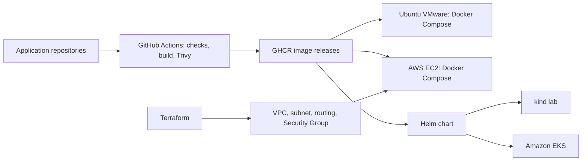
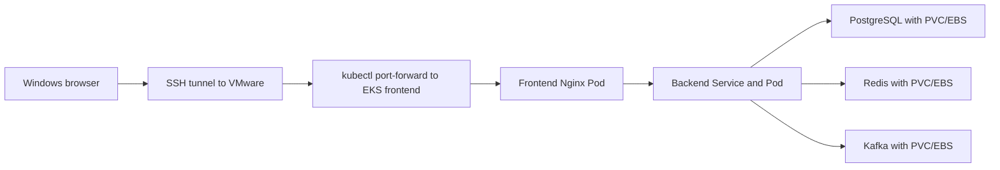

# URL Shortener — DevOps Learning Project

A personal project used to practice taking an application from an Ubuntu VMware environment to AWS EC2 and Kubernetes on Amazon EKS. The focus is reproducible deployment, observable behavior and troubleshooting.

**Repositories:** [Infrastructure](https://github.com/ThanhND05/url-shortener-infra) · [Backend](https://github.com/ThanhND05/url_shortener_be) · [Frontend](https://github.com/ThanhND05/url_shortener_fe)

## Deployment paths

EC2 infrastructure is provisioned with Terraform. The EKS cluster in this lab is provisioned with eksctl; application deployment to EKS uses Helm from the VMware administration machine.

The working EKS access path is:

## Work covered

- Ubuntu administration and Docker Compose deployment for the frontend, backend and supporting data services.
- GitHub Actions checks, container builds, Trivy scanning and GHCR release references.
- Terraform provisioning for the EC2 lab, restricted SSH ingress and a host Nginx reverse proxy.
- Helm deployment on kind and EKS, with configuration/Secret references, startup/readiness/liveness probes and persistent storage.
- Request testing and operational troubleshooting across the deployment paths.

This is a learning environment. PostgreSQL, Redis and Kafka each use a single replica. It does not demonstrate production availability or database HA.

## Measured redirect test

The existing [k6 report](evidence/k6-vm.json) records:

| Metric | Result |
|---|---|
| Environment | VMware Compose lab |
| Workload | Redirect endpoint; no destination following; up to 10 VUs over about 2 minutes |
| HTTP requests | 3,192 |
| Average request rate | Approximately 26.6 requests/s |
| Request duration p95 | Approximately 9.89 ms |
| HTTP failure rate | 0% |

The [workload source](../load-tests/redirect.js) defines the stages and checks. These measurements describe this run; they are not an EKS benchmark or a maximum-capacity claim. VM hardware, image digests and cache state should accompany any reused performance claim; those run details still need to be consolidated.

## Troubleshooting example: EKS NLB provisioning blocked

**Symptom:** the frontend Service remained `LoadBalancer / <pending>` while frontend/backend Pods were Running and the Service had a frontend endpoint.

**Investigation:** inspected Service Events and controller Pod status. AWS returned `OperationNotPermitted` for `CreateLoadBalancer`, stating the account did not currently support load balancer creation.

**Action:** submitted an account support request and used an EKS-specific port-forward plus an SSH tunnel to continue application checks. The exact account-side reason for the restriction has not been confirmed.

**Status:** public NLB and public TLS are not completed. Port-forward is a temporary administration/demo path. No claim is made that the load balancer restriction was resolved.

Another observed issue was EKS API timeout after the administrator's public IP changed. Comparing current egress IP with `publicAccessCidrs` identified an outdated allowlist; the API access configuration was updated to the current `/32`.

## Evidence to attach before sharing this case study

- Add a link to a successful backend/frontend CI run and the corresponding image references.
- Add sanitized EKS Pod/PVC output and a smoke PASS screenshot from the live lab.
- Add a short walkthrough video; a running public cluster is not required to view recorded evidence.
- Add restore/rollback results only after those exercises have actually succeeded.

These attachments are pending in this case study. The k6 report above is already in the repository. Source files for features are not substitutes for runtime evidence.

## Reproduce and inspect

- [Repository quick start](../README.md)
- [Kubernetes and EKS walkthrough](kubernetes-eks-intern-guide.md)
- [Helm chart](../charts/url-shortener/)
- [EC2 Terraform](../environments/aws-lab/)
- [Infrastructure workflows](../.github/workflows/)
- [Backend CI](https://github.com/ThanhND05/url_shortener_be/blob/main/.github/workflows/backend-ci.yml) and [Frontend CI](https://github.com/ThanhND05/url_shortener_fe/blob/main/.github/workflows/frontend-ci.yml)
- [Kubernetes verification scope](K8S_VALIDATION.md)

Use private environment files and lab-only credentials when reproducing. Kubernetes/EKS instructions include account prerequisites, resource costs and teardown steps. Repository validation reports describe author-side static checks separately from runtime exercises performed during the learning project.
